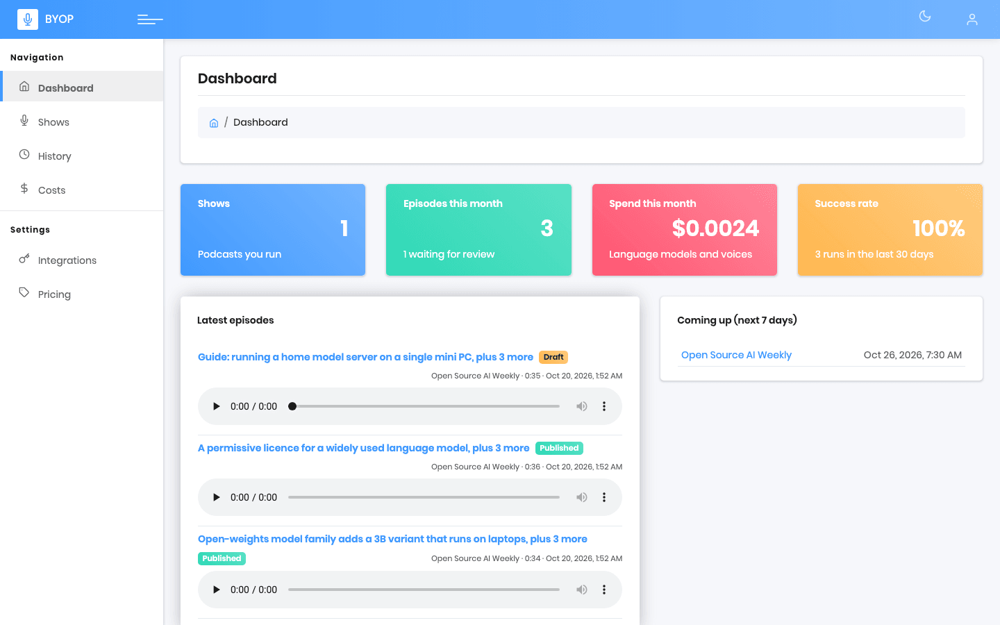
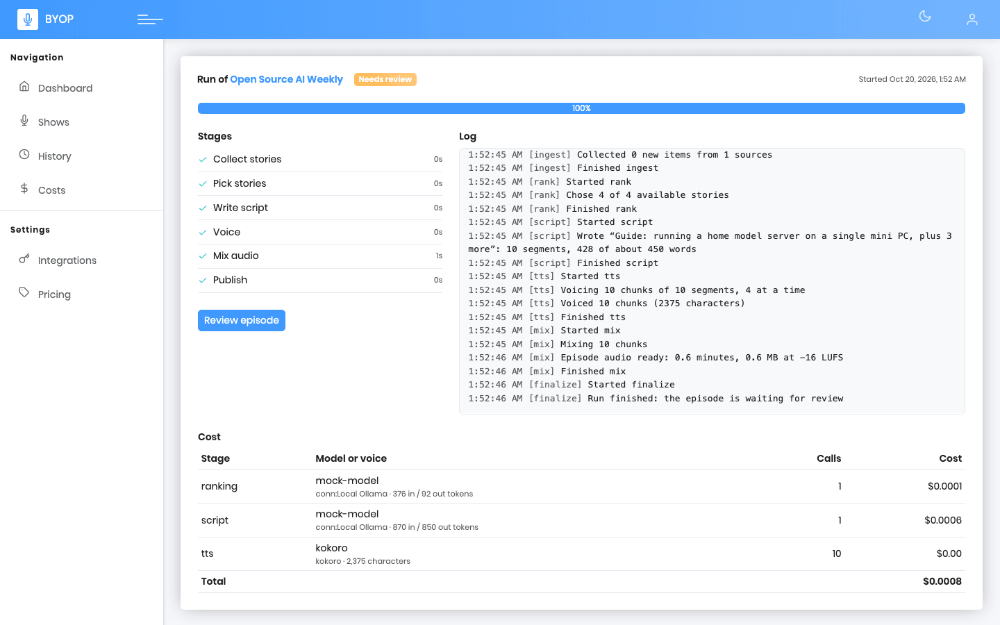
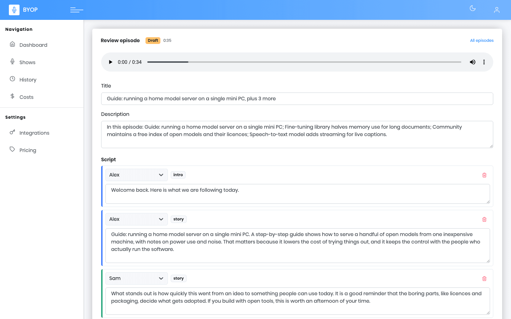
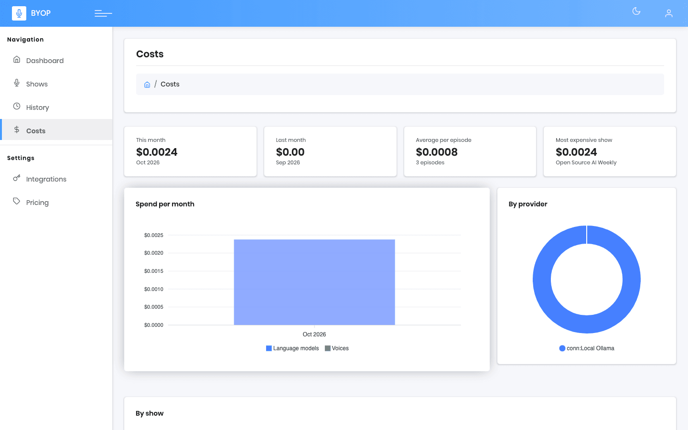
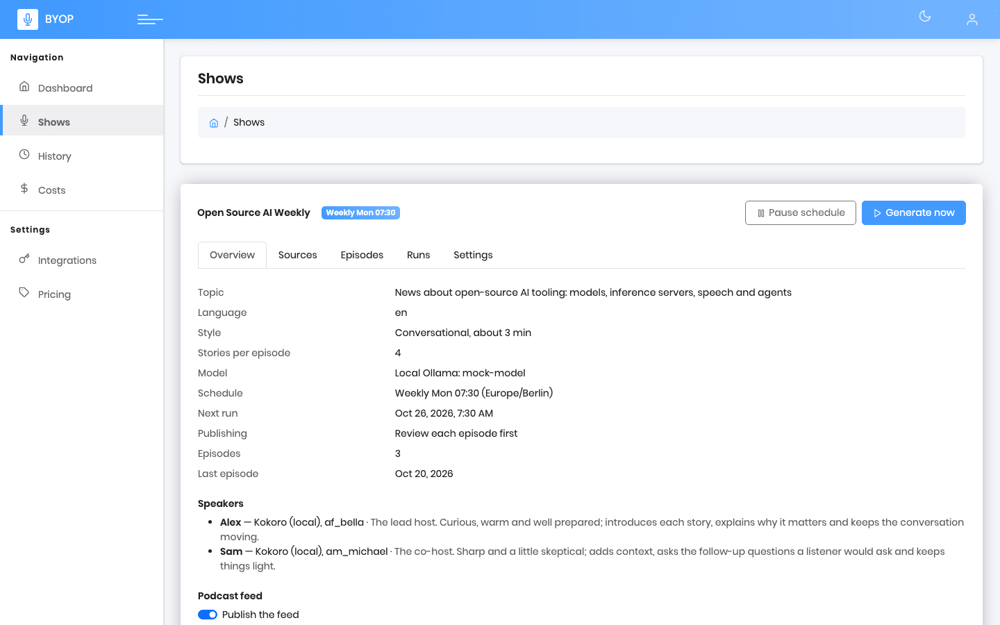
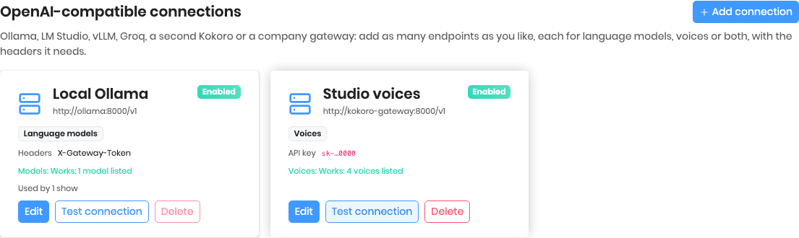
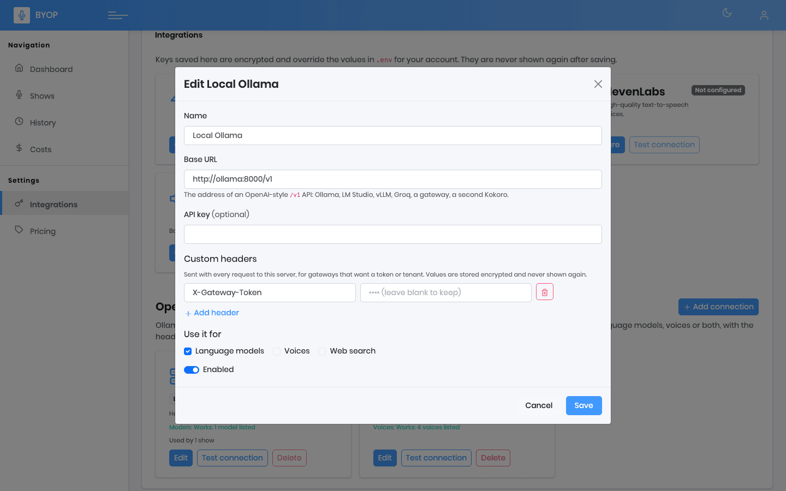
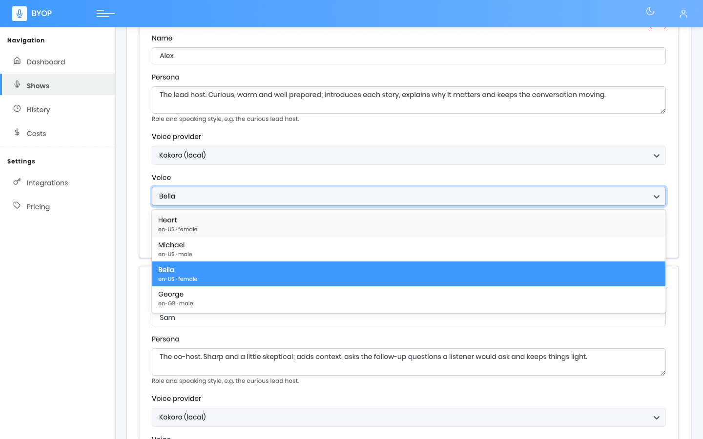
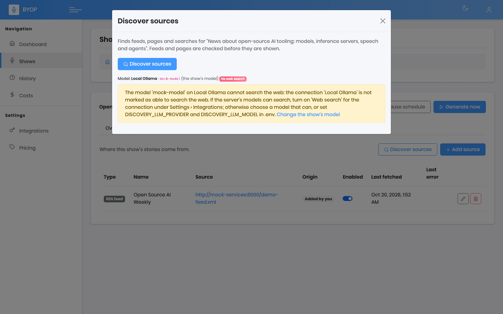
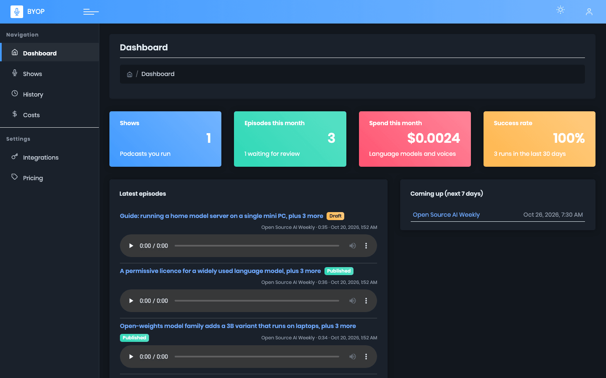

# BYOP — Bring Your Own Podcast

[](https://github.com/faaizzz/Bring-Your-Own-Podcast-BYOP/actions/workflows/ci.yml)

**Your sources in, a podcast out.** BYOP is a self-hosted, open-source app that turns the feeds,
pages and searches you care about into a recurring, multi-speaker AI podcast with its own RSS feed.
Bring your own language-model and voice keys, or run everything locally for free, and keep full
control of your data.



## What you get

- **Shows** with a topic, a style (news briefing, conversational, deep dive, interview), a schedule
  and a cast of named speakers, each with their own voice.
- **Sources:** RSS feeds, web pages and web-search queries, found for you from just a topic, or
  hand-picked. Stories are collected, de-duplicated and ranked; the best ones are covered.
- **Scripts** written by the model of your choice as a natural dialogue between your speakers.
- **Voices** from OpenAI, ElevenLabs, OpenRouter or local Kokoro, mixed with ffmpeg: gaps,
  intro/outro, a music bed, -16 LUFS loudness.
- **Review before you publish:** edit the script, re-voice it, approve or reject. Or auto-publish.
- **A public RSS feed** that works in Apple Podcasts, Spotify, Pocket Casts and every other app.
- **On a schedule:** daily, weekly or monthly, in your time zone, with pause and catch-up.
- **Know the cost:** every call is recorded; per-run, per-show and monthly spend with charts, an
  estimate before you generate, optional [Langfuse](docs/langfuse.md) tracing.

| Run, live | Episode review |
| --- | --- |
|  |  |

| Costs | A show and its feed |
| --- | --- |
|  |  |

### Your own servers, and searchable dropdowns

Add any number of OpenAI-compatible endpoints (Ollama, vLLM, a gateway, a second Kokoro) as
[connections](docs/providers.md#connections-any-openai-compatible-server), each for models, voices
or both, with the headers it needs. Every dropdown can be searched by typing, in light and dark
mode, and source discovery tells you up front when a model cannot search the web.

| Connections | Editing one: key and custom headers stay masked |
| --- | --- |
|  |  |

| A searchable dropdown | Discovery checks the model first |
| --- | --- |
|  |  |



*(The pictures come from `make screenshots` and show the end-to-end test's mock model and voices.)*

## Quickstart

You need Docker with the compose plugin. Three commands:

```sh
git clone https://github.com/faaizzz/Bring-Your-Own-Podcast-BYOP.git
cd Bring-Your-Own-Podcast-BYOP
make up        # creates .env, generates BYOP_SECRET_KEY, builds and starts the minimal stack
```

Open <http://localhost:8080> and sign in with `admin@example.com` / `change-me-now` (set your own
`BYOP_ADMIN_EMAIL` and `BYOP_ADMIN_PASSWORD` in `.env` before exposing the app). The dashboard walks
you through the first episode:

1. **Settings › Integrations:** add an OpenRouter or OpenAI key (or a local model, below), and a
   voice provider (ElevenLabs, OpenAI or OpenRouter key, or `make up-full` for free local voices).
2. **Shows › New show:** a title and a topic, pick the voices, a model and, optionally, a schedule.
3. **Sources tab:** *Discover sources* from the topic, or add feeds by hand.
4. Press **Generate now**, watch the run, review the episode and approve it.
5. Copy the show's feed address into your podcast app. [Publishing](docs/publishing.md) explains how
   to put it on the internet and into Apple Podcasts and Spotify.

### Minimal or full stack

`make up` starts the **minimal** stack: the app and its database, nothing optional. `make up-full`
adds free local voices, tracing and S3 storage:

| | `make up` (minimal) | `make up-full` |
| --- | --- | --- |
| Services | `api`, `worker`, `beat`, `web`, `postgres`, `redis` (6) | the six, plus `kokoro`, `langfuse-*` (web, worker, Postgres, ClickHouse, Redis) and `s3` |
| Memory (approx.) | 1 GB | 6 GB |
| Disk (images + data, approx.) | 2 GB | 10 GB |
| Voices | a paid key (ElevenLabs, OpenAI, OpenRouter) | the same, or free local voices (Kokoro) |
| Pick it when | you have API keys, or you only try the app | you want to run without paid keys, trace LLM calls or try S3 |

Pick optional parts with `BYOP_PROFILES`, for example `BYOP_PROFILES="kokoro" make up-full`.
Details: [configuration](docs/configuration.md#minimal-and-full-stack).

### Zero-cost mode

No paid keys? Run the voices locally with [Kokoro](docs/providers.md#local-voices-with-kokoro-no-api-key)
and the language model with [Ollama](docs/providers.md#zero-cost-mode-kokoro-voices-and-a-local-model):

```sh
make up-kokoro                 # minimal stack plus a free local text-to-speech server
ollama pull qwen2.5:14b        # on your machine; then add it under Integrations › Add connection
```

### Providers

| | OpenRouter | OpenAI | ElevenLabs | Kokoro (local) | Connections (Ollama, vLLM, gateways…) |
| --- | :-: | :-: | :-: | :-: | :-: |
| Language models | ✓ | ✓ | | | ✓ |
| Voices | ✓ | ✓ | ✓ | ✓ | |
| Cost reported by the provider | ✓ | | | | |
| Needs a key | ✓ | ✓ | ✓ | | |

Details, and how to add another provider: [providers](docs/providers.md).

## Everyday commands

`make screenshots` (regenerate the pictures above) · `make up` (minimal) · `make up-full` (+ local voices, tracing, S3) · `make down` (stops everything) ·
`make down-v` (also deletes the data) · `make logs` · `make build` · `make up-kokoro` · `make up-minio` ·
`make up-langfuse` (single-profile aliases of `up-full`) · `make check` (lint, types, tests) · `make e2e` (browser test) ·
`make help` lists them all. In development `docker-compose.override.yml` mounts the API source for
hot reload; for a production-like run use `docker compose -f docker-compose.yml up -d --build`, or run a
published release without building: [releasing](docs/releasing.md).

## Documentation

**Use it**

- [Configuration: every environment variable](docs/configuration.md)
- [Model providers (OpenRouter, OpenAI, Ollama, Kokoro) and adding one](docs/providers.md)
- [Shows](docs/shows.md) · [Sources](docs/sources.md) · [Scheduling](docs/scheduling.md)
- [Reviewing episodes](docs/review.md) · [Dashboard](docs/dashboard.md)
- [Podcast feed](docs/feed.md) · [Publishing to directories](docs/publishing.md)
- [Usage and costs](docs/costs.md) · [Langfuse tracing](docs/langfuse.md)
- [Media storage (local or S3) and covers](docs/storage.md)
- [Backup and restore](docs/backup.md) · [Secrets, hardening and key rotation](docs/security.md)
- [Releases and upgrades](docs/releasing.md) · [Changelog](CHANGELOG.md)

**How it works**

- [Architecture](docs/architecture.md)
- [Runs (the pipeline)](docs/runs.md) · [Ingest](docs/ingest.md) · [Choosing stories](docs/ranking.md) ·
  [Scripts](docs/scripts.md) · [Voicing](docs/tts.md) · [Episode audio](docs/audio.md)
- [End-to-end test](docs/e2e.md)

## Contributing

Contributions are welcome: see [CONTRIBUTING.md](CONTRIBUTING.md) and the
[Code of Conduct](CODE_OF_CONDUCT.md). Report security problems privately as described in
[SECURITY.md](SECURITY.md). The roadmap lives in the
[GitHub issues](https://github.com/faaizzz/Bring-Your-Own-Podcast-BYOP/issues) and the
[project board](https://github.com/users/faaizzz/projects/2).

## License

[MIT](LICENSE)

The admin UI theme is derived from the MIT-licensed
[Gradient Able](https://github.com/codedthemes/gradient-able-free-admin-template)
free template by CodedThemes; its licence notice is kept in
[`apps/web/src/theme/LICENSE-gradient-able`](apps/web/src/theme/LICENSE-gradient-able).
