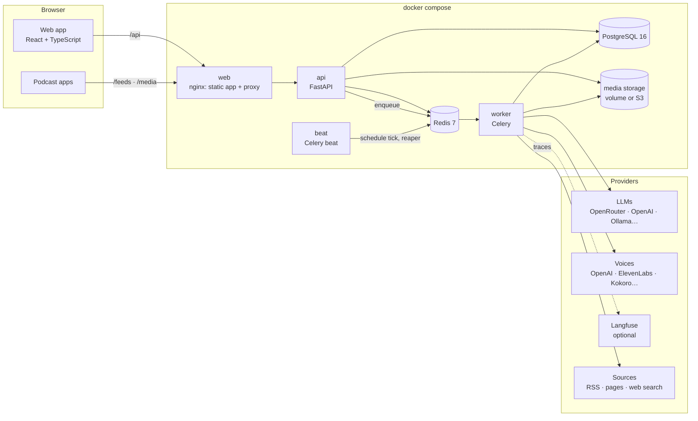
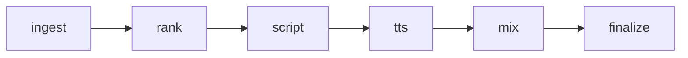

# Architecture

BYOP is a small set of containers around one PostgreSQL database. Nothing is hidden in the
browser: the web app is a client of the same HTTP API you can call yourself.



| Service | Role |
| --- | --- |
| `web` | nginx serving the built app and proxying `/api`, `/feeds` and `/media` to the API (with an unbuffered location for the live run stream) |
| `api` | FastAPI. Routers are thin; domain logic lives in `services/`. Runs migrations at start and seeds the admin |
| `worker` | Celery. Runs the pipeline stages, source discovery and ingest jobs |
| `beat` | Celery beat. Every minute queues due scheduled runs; every `RUN_REAPER_INTERVAL_S` fails stuck runs |
| `postgres` | All state: shows, runs and their logs, episodes, usage events, encrypted credentials |
| `redis` | Celery broker, caches (model lists), rate limits, job state, and the channel that wakes live run streams |
| media | Episode audio, covers and branding clips under `shows/<id>/`, on a volume or any S3-compatible store |

Optional profiles add Kokoro (local voices), a RustFS S3 store and a self-hosted Langfuse.

## A generation run

A run is a chain of Celery tasks, one per stage, each an independent function over a `RunContext`
(`apps/api/byop/pipeline/`):



| Stage | What it does | Detail |
| --- | --- | --- |
| `ingest` | Collects stories from the show's sources, de-duplicates them | [ingest](ingest.md) |
| `rank` | Has the model choose the best stories and merges duplicates; reserves them for the run | [ranking](ranking.md) |
| `script` | The model writes the multi-speaker script; the draft episode is created | [scripts](scripts.md) |
| `tts` | Voices each line, in parallel chunks, with a fallback voice | [voicing](tts.md) |
| `mix` | Joins the lines with gaps, adds intro/outro/music, normalises loudness with ffmpeg | [audio](audio.md) |
| `finalize` | Publishes the draft, or leaves it for review; settles the stories and the run's cost | [review](review.md) |

Every stage logs and reports progress through the context, which is also the run's heartbeat. The
orchestrator (`pipeline/orchestrator.py`) guarantees a run ends in a final state: stages finish it,
failures and cancellations end it early, and the reaper catches anything that stopped reporting
([runs](runs.md)). A re-synthesis of an edited draft runs only `tts`, `mix` and `finalize`.

Each stage also feeds usage and tracing: providers report every call, a collector stores it as
`usage_events` ([costs](costs.md)) and Langfuse receives the same calls ([langfuse](langfuse.md)).

## Code layout

```
apps/api/byop/
  api/         routers, one file per resource
  services/    domain logic (never in routers); every query filters by user_id
  pipeline/    orchestrator, RunContext and the stages
  providers/   llm/ and tts/ adapters behind one interface each
  storage/     Storage interface with local and S3 backends
  models/ schemas/  SQLAlchemy models and pydantic request/response models
  tasks/       thin Celery tasks that call services
apps/web/src/  pages/<area>, lib/ (API client and TanStack Query hooks), layout/, theme/
docker/        Dockerfiles and nginx.conf
```

[CLAUDE.md](../CLAUDE.md) has the conventions in full.

## Design decisions worth knowing

- **The database is the source of truth.** Live views (the run stream) only use Redis to wake up;
  they re-read the database, so a missed message delays an update but never loses it.
- **Providers never touch the database.** They report each call; the owner of the work stores it.
- **One user today, many tomorrow.** Every owned table has a `user_id` and every query filters by it;
  adding sign-up needs no schema change to those tables.
- **Public by exception.** Only health, login, the feed, episode audio and covers are reachable
  without a session; a test fails if any other route is.
- **Server-side fetches are guarded.** Anything fetched from a user-supplied URL goes through one
  function that refuses private addresses ([sources](sources.md)).
